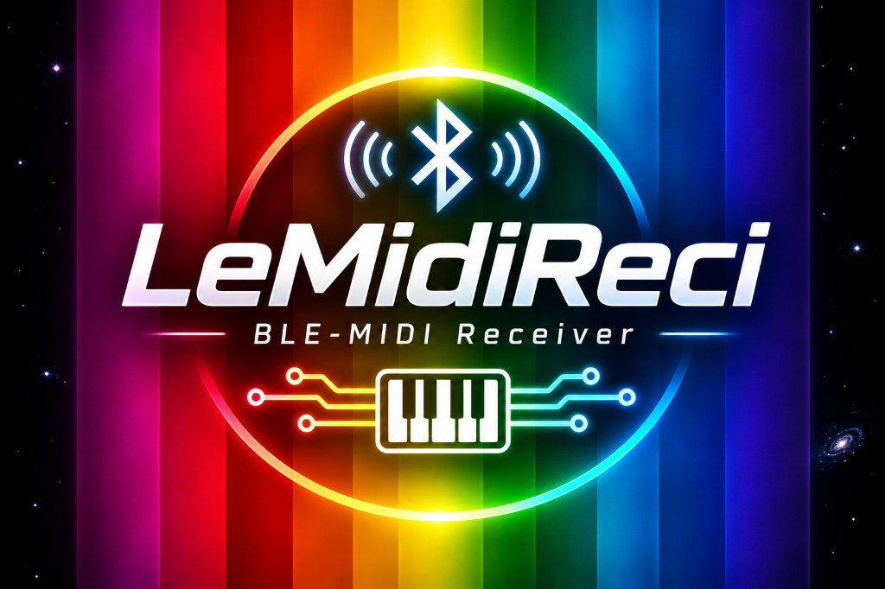

<p align="center">
  
</p>

# LeMidiReci

LeMidiReci is an ESP32 BLE-MIDI receiver. It connects to up to three BLE-MIDI peripherals, remaps each device onto a fixed MIDI channel, and can forward the commands as binary MIDI over USB serial.

It also advertises as a BLE-MIDI peripheral named **LeMidiReci** while it is not holding a connection of its own. Advertising stops as soon as an outgoing MIDI link is up, so the radio can keep those links alive.

## Hardware

| | ESP32-WROOM-32 | ESP32-C3 |
|---|---|---|
| Board in the Arduino IDE | ESP32 Dev Module | ESP32C3 Dev Module |
| USB serial | external USB-UART (CP2102) | native USB. Enable **USB CDC On Boot** |
| BLE links | 3 | 3 |
| OLED SDA | GPIO 5 | GPIO 5 |
| OLED SCL | GPIO 4 | GPIO 4 |
| OLED controller | SSD1306, 128×64, I²C address `0x3C` | same |
| Activity LED | not used unless enabled | GPIO 8, active low |

Pick the board in the IDE. The sketch follows that choice. Force a target only if detection is wrong:

```cpp
#define BOARD_ESP32C3 0   // ESP32-WROOM-32
#define BOARD_ESP32C3 1   // ESP32-C3
```

Leave that line commented for normal use.

If the boot log shows `flash read err, 1000`, set **Flash Frequency** to **40 MHz** and upload again.

## Libraries

Install from the Arduino Library Manager:

- [NimBLE-Arduino](https://github.com/h2zero/NimBLE-Arduino) 2.x
- Adafruit SSD1306
- Adafruit GFX Library (required by SSD1306)

Open `LeMidiReci.ino` and upload.

## Configuration

All switches are at the top of `LeMidiReci.ino`.

### Serial

```cpp
#define SERIAL_MODE 2
```

| Value | Serial output at 115200 baud |
|---|---|
| `0` | none |
| `1` | binary MIDI commands only, after channel remap |
| `2` | debug text, plus each BLE packet as hex (`RX <address> K<channel>: ...`) |

Mode `1` is for a serial MIDI port. A text monitor shows those bytes as garbage. Mode `2` is for bringing the link up.

### Display

```cpp
#define USE_DISPLAY 0
```

Set this to `1` to drive the OLED. The top line is the link count (`Verbunden 2/3`). Under it, the latest MIDI commands scroll, three bytes each:

```text
Verbunden 2/3
92 30 52
81 32 40
```

Clock and Active Sensing are not shown.

### Activity LED

```cpp
#define LED_BUILTIN 8
```

Uncomment that line to flash GPIO 8 for about 30 ms on every MIDI command. The LED on these C3 boards is active low. Leave the line commented and the pin is not touched.

### MIDI channel map

```cpp
static const DeviceChannel kDeviceChannels[] = {
  { "SMC-PAD Pocket", 2 },
  { "SMC-PAD",        3 },
};
```

`id` is either the advertised name or the BLE address (`aa:bb:cc:dd:ee:ff`). Matching is case-insensitive. An address match wins over a name match. A device that is not listed stays on **channel 1**. Channels are numbered 1–16.

Channel voice messages (notes, control change, program change, pitch bend, aftertouch) are rewritten. System real-time messages and SysEx are left unchanged.

## Behaviour

1. The ESP32 scans for the standard BLE-MIDI service `03B80E5A-EDE8-4B33-A751-6CE34EC4C700`.
2. It connects to the first new peripheral, subscribes to notifications, then keeps scanning until three links are in use.
3. A second connection uses a shorter scan window so the first link is not dropped. Disconnect reason `520` is a supervision timeout: the radio ran out of time.
4. While any outgoing MIDI device is connected, LeMidiReci does not advertise.
5. With no outgoing link, other hosts can connect to **LeMidiReci** and write MIDI to it. Those peers count toward the same limit of three BLE links.

## BLE MIDI

| | UUID |
|---|---|
| Service | `03B80E5A-EDE8-4B33-A751-6CE34EC4C700` |
| Characteristic | `7772E5DB-3868-4112-A1A9-F2669D106BF3` |

Packets follow the MMA / Apple BLE-MIDI layout: a header, then a timestamp byte before each MIDI message.

## License

LeMidiReci is free software, released under the [GNU General Public License v3.0](LICENSE) or, at your option, any later version.
