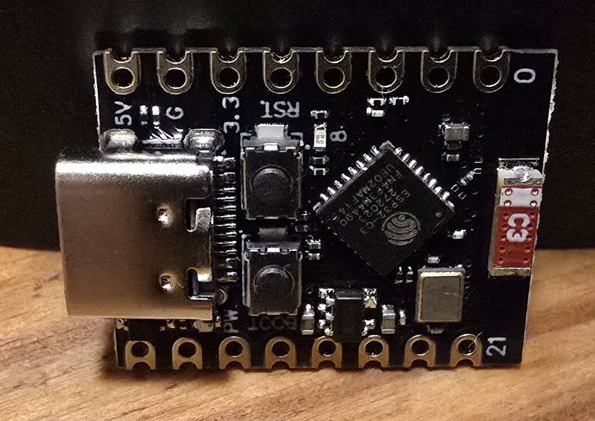
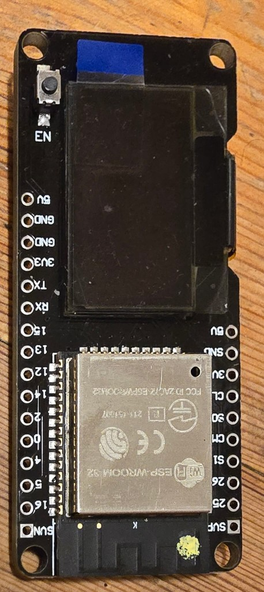
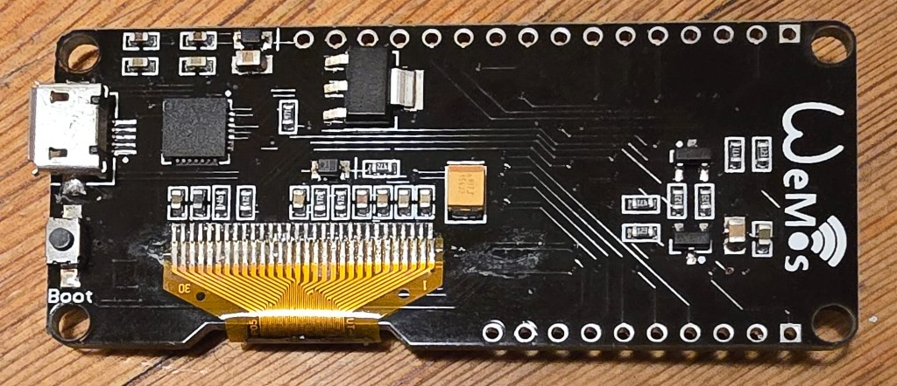

# Hardware and sources

This page records the four devices used with LeMidiReci, and the documents behind each claim. It does not copy code or pictures from those projects. The photographs were taken of the units in this project.

Evidence is marked as one of:

| Mark | Meaning |
|---|---|
| Photo | Readable on the photographed unit |
| Datasheet | Espressif document for the chip or module, not for the carrier board |
| Community | A third-party board page or repository. Vendors of the same outline differ |
| Firmware | What `LeMidiReci.ino` assumes |
| Not measured | Not checked with a meter, a logic trace, or a running test on this unit |

Chip manufacturer and board manufacturer are separate. A logo on the module is not the maker of the carrier board.

## ESP32-C3 SuperMini

Compact development board. The chip is an Espressif ESP32-C3. No company name is printed on this unit, so the board manufacturer is unknown. [NuttX](https://nuttx.incubator.apache.org/docs/latest/platforms/risc-v/esp32c3/boards/esp32c3-supermini/index.html) documents one SuperMini variant as Tenstar Robot and warns that LED color, flash size, and antenna layout vary by vendor. This unit is not identified as that variant.

   
  <em>Component side. The chip is marked ESP32-C3. USB-C is on the left, and the silkscreen shows 5V, G, 3.3, RST, BOOT, 8, 0, and 21.</em>

   
  <em>Back. The silkscreen reads ESP32 C3 Super Mini. One header is 5, 6, 7, 8, 9, 10, 20, 21. The other is 5V, G, 3.3, 4, 3, 2, 1, 0.</em>

| | |
|---|---|
| Name on the unit | ESP32 C3 Super Mini |
| Chip manufacturer | Espressif |
| Chip | ESP32-C3, read from the package marking (photo) |
| Board manufacturer | Unknown. Not printed on this unit |
| USB | USB-C receptacle (photo). Native USB Serial/JTAG is a chip feature ([ESP32-C3 datasheet](https://documentation.espressif.com/esp32-c3_datasheet_en.html)) |
| Headers | Pins 0–10, 20, and 21, plus 5V, G, and 3.3 (photo). The same outline is described for the V1601 silkscreen by [NuttX](https://nuttx.incubator.apache.org/docs/latest/platforms/risc-v/esp32c3/boards/esp32c3-supermini/index.html) (community) |
| BOOT | A button is labeled BOOT (photo). NuttX maps that button to GPIO9 and notes GPIO9 is a strapping pin (community). GPIO9 is not printed next to the button. Not measured |
| Reset | Silkscreen RST, and a reset button (photo). NuttX says RESET is the chip-enable line and is not a GPIO (community) |
| LED | A blue LED is on the board (photo). Pin 8 is labeled (photo). NuttX and [zfrkrc/supermini_esp32c3](https://github.com/zfrkrc/supermini_esp32c3) describe the user LED as GPIO8, active low, and warn that GPIO8 must stay high at reset (community). This unit was not measured |
| Firmware LED | `LED_BUILTIN 8`, `LED_ACTIVE_LOW 1` (firmware). Comment it out to leave the pin alone |
| Firmware MIDI UART | TX GPIO 7, RX GPIO 6, `Serial1`, 31250 8N1 (firmware). Pins 6 and 7 are on the header (photo). They are not labeled as MIDI. NuttX lists GPIO6 as SPI clock and GPIO7 as SPI MOSI (community) |
| USB pins | Not broken out. NuttX assigns GPIO19 to USB D+ and GPIO18 to USB D− on the connector only (community). Not traced on this unit |

Primary pages: [Espressif](https://www.espressif.com/), [ESP32-C3 datasheet](https://documentation.espressif.com/esp32-c3_datasheet_en.html), [NuttX SuperMini](https://nuttx.incubator.apache.org/docs/latest/platforms/risc-v/esp32c3/boards/esp32c3-supermini/index.html), [zfrkrc/supermini_esp32c3](https://github.com/zfrkrc/supermini_esp32c3).

## WeMos-marked ESP32 OLED board

The module is an Espressif ESP-WROOM-32. The back of this carrier is marked WeMos. That shows a brand on the silkscreen. It does not by itself prove an official WEMOS or LOLIN factory board. [pjpmarques/LOLIN-ESP32-OLED](https://github.com/pjpmarques/LOLIN-ESP32-OLED) documents the Wemos Lolin ESP32 OLED and clones. Treat that pinout as community documentation for the family.

   
  <em>Front. ESP-WROOM-32 shield, OLED, and headers. Readable labels include EN, 5V, GND, 3V3, TX, RX, 15, 13, 12, 14, 27, 16, 17, CL, DA, 25, and 26. Some pads are hidden by the shield.</em>

   
  <em>Back. WeMos mark, Micro-USB, Boot button, and the OLED flex cable.</em>

| | |
|---|---|
| Module manufacturer | Espressif |
| Module | ESP-WROOM-32, read from the shield (photo). [ESP32-WROOM-32 datasheet](https://documentation.espressif.com/esp32-wroom-32_datasheet_en.html) |
| Board mark | WeMos, on the back (photo) |
| Board manufacturer | Not established. The mark is WeMos. Whether this unit is an original WEMOS/LOLIN board or a clone was not traced to a factory |
| USB | Micro-USB on the back (photo). This project treats the serial port as an external USB-UART on UART0 (firmware). The converter chip was not identified from the photograph |
| Display | OLED panel on the front, flex cable on the back (photo). Controller chip not readable through the bezel |
| I²C labels | The right header prints CL and DA (photo). It does not print GPIO numbers for those pads |
| I²C pins used by this firmware | SDA GPIO 5, SCL GPIO 4, address `0x3C` (firmware). The same three values are what [LOLIN-ESP32-OLED](https://github.com/pjpmarques/LOLIN-ESP32-OLED) gives for that board family (community). They were not read as numbers off this silkscreen, and they were not measured for this page |
| Other silkscreen | EN, TX, RX, 15, 13, 12, 14, 27, 16, 17, 25, 26, 5V, GND, 3V3 (photo) |
| Boot | Button labeled Boot (photo). GPIO number of that button was not measured |
| Firmware MIDI UART | TX GPIO 17, RX GPIO 16, `Serial2`, 31250 8N1 (firmware). Pins 16 and 17 are labeled (photo). They are not labeled as MIDI |
| Display switch | `USE_DISPLAY 0` in the current tree, so these pins are unused until that switch is set to 1 (firmware) |

Primary pages: [Espressif](https://www.espressif.com/), [ESP32-WROOM-32 datasheet](https://documentation.espressif.com/esp32-wroom-32_datasheet_en.html), [LOLIN-ESP32-OLED](https://github.com/pjpmarques/LOLIN-ESP32-OLED).

## M-VAVE SMC-PAD

Sixteen-pad BLE-MIDI controller. The face of this unit is printed M-VAVE. M-VAVE's product page is the manufacturer reference. This firmware only receives BLE-MIDI. It does not send the configuration writes described by the reverse-engineering projects.

   
  <em>Photographed unit. Sixteen pads in a 4×4 grid, rotary knobs on the left (1–6 are numbered), and the right-hand buttons BT, PAD BANK, KNOB BANK, transport, SHIFT, and NOTE REPEAT.</em>

| | |
|---|---|
| Name | SMC-PAD |
| Brand on the unit | M-VAVE (photo) |
| Product manufacturer | M-VAVE, [product page](https://www.m-vave.com/product?id=smc-pad). The factory behind the brand is not identified here |
| Chip manufacturer | Not visible. Not claimed |
| Pads | 16, labeled PAD1–PAD16 (photo) |
| Knobs | Rotary knobs on the left. Numbers 1–6 are printed (photo). A top pair has no number in this photograph. [spectalive/smc-pad](https://github.com/spectalive/smc-pad) describes eight encoders (community) |
| Other controls | BT, PAD BANK, KNOB BANK, cursor, play, pause, record, SHIFT, NOTE REPEAT (photo) |
| Aftertouch | Named in the product description used for this project and on the [manufacturer page](https://www.m-vave.com/product?id=smc-pad). This firmware has not checked that aftertouch arrives |
| LEDs | Pads are described as RGB by the project and by [spectalive/smc-pad](https://github.com/spectalive/smc-pad) (community). No color write is implemented here. See the RGB section of the README |
| Radio role in this firmware | BLE-MIDI peripheral. Channel map entry `"SMC-PAD"` → channel 3 (firmware) |
| MIDI service | Standard BLE-MIDI UUIDs, [MIDI Association](https://midi.org/midi-over-bluetooth-low-energy-ble-midi) |

Community protocol notes, not used by this firmware: [spectalive/smc-pad](https://github.com/spectalive/smc-pad), [fedepaj/open-smc-pad](https://github.com/fedepaj/open-smc-pad). Those repositories are under their own licenses. Nothing from them is copied here.

Manufacturer downloads: [m-vave.com/download](https://www.m-vave.com/download), [app download](https://www.m-vave.com/appdownload).

## M-VAVE SMC-PAD Pocket

Smaller 16-pad controller. This photograph shows the pad surface only. It does not show a M-VAVE wordmark. The product name is the one used by this project and by [M-VAVE's product page](https://www.m-vave.com/product?id=smc-pad-pocket).

   
  <em>Sixteen pads. The top row is also marked PRESETS 1–4. No knobs are in the frame.</em>

| | |
|---|---|
| Name | SMC-PAD Pocket |
| Brand | M-VAVE, from the [product page](https://www.m-vave.com/product?id=smc-pad-pocket). Not printed in this photograph |
| Product manufacturer | M-VAVE. Factory not identified here |
| Chip manufacturer | Not visible. Not claimed |
| Pads | 16, labeled PAD 1–PAD 16 (photo). Top row also marked PRESETS 1–PRESETS 4 (photo) |
| Knobs | None in this photograph |
| LEDs | [SageSchiller/thump](https://github.com/SageSchiller/thump) describes Pocket pad lights and says the Pocket uses the same settings protocol as the larger pad (community). Not implemented and not tested here |
| Radio role in this firmware | BLE-MIDI peripheral. Channel map entry `"SMC-PAD Pocket"` → channel 2 (firmware). The match is the whole name, so it does not collide with `"SMC-PAD"` |
| MIDI service | Standard BLE-MIDI UUIDs, [MIDI Association](https://midi.org/midi-over-bluetooth-low-energy-ble-midi) |

## Libraries and standards

These are the software references for the firmware. Versions used to compile are in the README. The library licenses apply to those projects, not to the photographs above.

| Reference | Role here |
|---|---|
| [arduino-esp32](https://github.com/espressif/arduino-esp32) | Board cores for ESP32 Dev Module and ESP32C3 Dev Module |
| [NimBLE-Arduino](https://github.com/h2zero/NimBLE-Arduino) | BLE central and peripheral, 2.x API |
| [Adafruit SSD1306](https://github.com/adafruit/Adafruit_SSD1306) | OLED driver, compiled only when `USE_DISPLAY` is 1 |
| [Adafruit GFX](https://github.com/adafruit/Adafruit-GFX-Library) | Text drawing for that display |
| [MIDI over BLE](https://midi.org/midi-over-bluetooth-low-energy-ble-midi) | Packet layout implemented in `midi_ble.h` |

## Known limits and tests still open

| Item | State |
|---|---|
| SuperMini board manufacturer | Unknown on this unit. Do not treat the NuttX Tenstar note as the maker of this board |
| SuperMini LED on GPIO8, active low | Community description and firmware default. The blue LED has not been toggled on this unit |
| SuperMini BOOT button is GPIO9 | Community description. The button label is confirmed. The GPIO number is not printed and was not measured |
| OLED SDA GPIO 5, SCL GPIO 4, address `0x3C` | Firmware and the LOLIN-ESP32-OLED family note. CL and DA are printed. The GPIO numbers are not printed on those pads and were not measured |
| WeMos mark versus official LOLIN | Silkscreen only. Clone versus original was not determined |
| SMC-PAD aftertouch | Manufacturer product claim. Not captured by this firmware |
| SMC-PAD knob count of eight | Community description. This photo clearly numbers knobs 1–6 |
| Pad RGB writes | Not implemented. Public notes disagree on whether a write survives power-off. See the README |
| UART at 31250 baud | Pins are the firmware choice on headers that exist. No logic-analyzer capture |
| Two pads connected at once, disconnect, reconnect, reason 520 | Not retested on these units for this revision |
| OLED contents and the activity LED | Not tested on these units for this revision |
| USB-MIDI class device | Not provided. USB serial mode 1 is raw bytes on a COM port |
| MIDI DIN from GPIO TX | Not a DIN output. A separate output circuit is required and was not built for this page |
