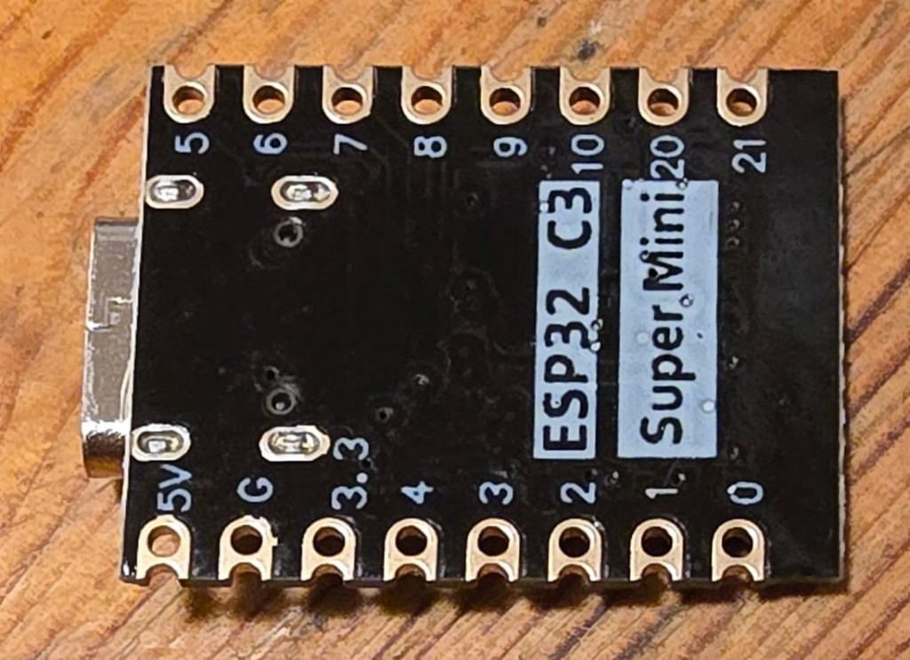
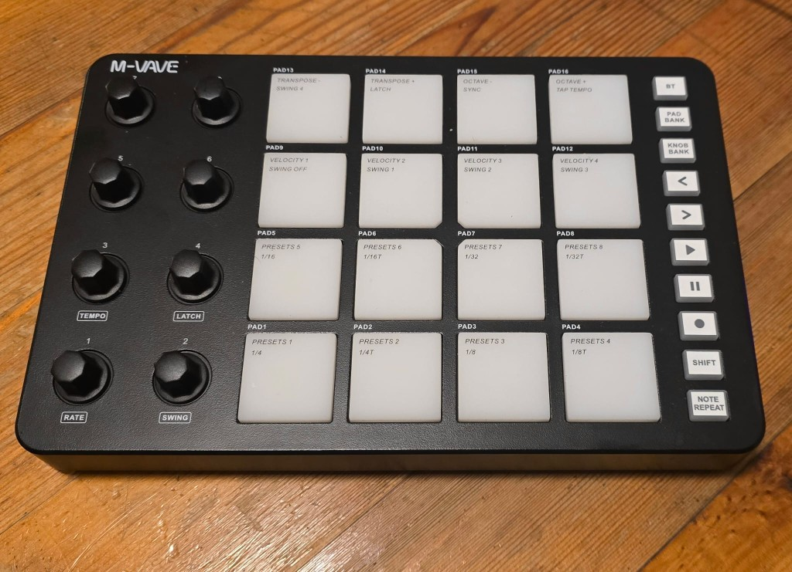
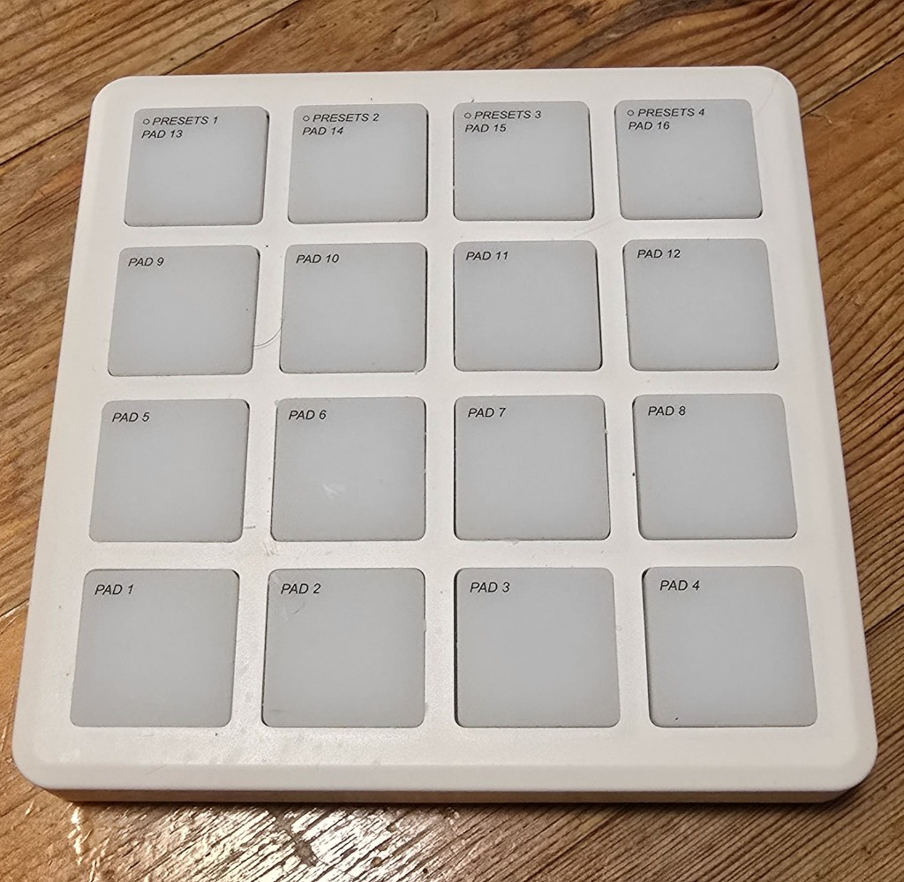

# Hardware and sources

This page records the four devices used with LeMidiReci, and the documents behind each claim. It does not copy code or pictures from those projects. The photographs were taken of the units in this project.

Evidence is marked as one of:

| Mark | Meaning |
|---|---|
| Photo | Readable on the photographed unit |
| Datasheet | Espressif document for the chip or module, not for the carrier board |
| Community | A third-party board page or repository. Vendors of the same outline differ |
| Firmware | What `LeMidiReci.ino` and `midi_ble.h` do in this tree |
| Not measured | Not checked with a meter, a logic trace, or a running test on this unit for this revision |

Chip manufacturer and board manufacturer are separate. A logo on the module is not the maker of the carrier board.

## ESP32-C3 SuperMini

Compact development board. The chip is an Espressif ESP32-C3. No company name is printed on this unit, so the board manufacturer is unknown. [NuttX](https://nuttx.incubator.apache.org/docs/latest/platforms/risc-v/esp32c3/boards/esp32c3-supermini/index.html) documents one SuperMini variant as Tenstar Robot and warns that LED color, flash size, and antenna layout vary by vendor. This unit is not identified as that variant.

   
  <em>Component side. The chip is marked ESP32-C3. USB-C is on the left, and the silkscreen shows 5V, G, 3.3, RST, BOOT, 8, 0, and 21.</em>

   
  <em>Back. The silkscreen reads ESP32 C3 Super Mini. One header is 5, 6, 7, 8, 9, 10, 20, 21. The other is 5V, G, 3.3, 4, 3, 2, 1, 0.</em>

### Strapping pins

ESP32-C3 boot mode is sampled from GPIO2, GPIO8, and GPIO9 at reset and then latched. After that hold time the pins are ordinary GPIOs. Sources: [ESP32-C3 datasheet](https://documentation.espressif.com/esp32-c3_datasheet_en.html), section Boot Configurations, Table 3-3 Chip Boot Mode Control, and [esptool boot-mode selection for the ESP32-C3](https://docs.espressif.com/projects/esptool/en/latest/esp32c3/advanced-topics/boot-mode-selection.html).

| GPIO9 | GPIO8 | Result |
|---|---|---|
| High | Any value | SPI boot. The ROM runs the program in flash. GPIO8 does not select this mode |
| Low | High | Joint download boot. UART download and USB-Serial-JTAG download are both in this mode |
| Low | Low | Not a valid combination for that download mode. esptool documents GPIO8 = 0 together with GPIO9 = 0 as invalid |

GPIO9 has a weak pull-up, so an open GPIO9 reads high and the chip SPI-boots (datasheet default, bit value 1). The datasheet also lists GPIO2 in the boot table and says GPIO2 does not choose between SPI boot and joint download; it recommends holding GPIO2 high. GPIO8 is a separate strap for ROM message printing (datasheet section 3.2). That print strap is not the SPI-boot choice.

The BOOT button is labeled on this unit (photo). NuttX maps that button to GPIO9 (community). The GPIO number is not printed beside the button and was not measured.

| | |
|---|---|
| Name on the unit | ESP32 C3 Super Mini |
| Chip manufacturer | Espressif |
| Chip | ESP32-C3, read from the package marking (photo) |
| Board manufacturer | Unknown. Not printed on this unit |
| USB | USB-C receptacle (photo). Native USB Serial/JTAG is a chip feature ([ESP32-C3 datasheet](https://documentation.espressif.com/esp32-c3_datasheet_en.html)) |
| Headers | Pins 0–10, 20, and 21, plus 5V, G, and 3.3 (photo). The same outline is described for the V1601 silkscreen by [NuttX](https://nuttx.incubator.apache.org/docs/latest/platforms/risc-v/esp32c3/boards/esp32c3-supermini/index.html) (community) |
| BOOT | Button labeled BOOT (photo). NuttX maps it to the GPIO9 strap (community). Not measured |
| Reset | Silkscreen RST, and a reset button (photo). NuttX says RESET is the chip-enable line and is not a GPIO (community) |
| LED | An LED is fitted on the board (photo). It is presumed to be GPIO8, active low, from [NuttX](https://nuttx.incubator.apache.org/docs/latest/platforms/risc-v/esp32c3/boards/esp32c3-supermini/index.html) and [zfrkrc/supermini_esp32c3](https://github.com/zfrkrc/supermini_esp32c3) (community). The color it emits was not electrically tested (not measured) |
| Firmware LED | On the C3 build only: `LED_BUILTIN 8`, `LED_ACTIVE_LOW 1` (firmware). Comment `LED_BUILTIN` out and the pin is left untouched. The WROOM build does not define `LED_BUILTIN` |
| Firmware MIDI UART | `ENABLE_UART_MIDI` is 1: TX GPIO 7, RX GPIO 6, `Serial1`, 31250 8N1, no inversion (firmware). Pins 6 and 7 are on the header (photo). They are not labeled as MIDI. NuttX lists GPIO6 as SPI clock and GPIO7 as SPI MOSI (community) |
| USB pins | Not broken out. NuttX assigns GPIO19 to USB D+ and GPIO18 to USB D− on the connector only (community). Not traced on this unit |
| USB CDC | The C3 sketch uses the Arduino USB serial port. The board menu used for the recorded C3 compile is **USB CDC On Boot: Enabled**. With `SERIAL_MODE` greater than 0, `setup()` waits up to 1500 ms for `Serial` (firmware). `SERIAL_MODE` in this tree is 2, so that port is debug text at 115200 baud, not a MIDI byte stream and not a USB-MIDI class device |

Primary pages: [Espressif](https://www.espressif.com/), [ESP32-C3 datasheet](https://documentation.espressif.com/esp32-c3_datasheet_en.html), [esptool ESP32-C3 boot mode](https://docs.espressif.com/projects/esptool/en/latest/esp32c3/advanced-topics/boot-mode-selection.html), [NuttX SuperMini](https://nuttx.incubator.apache.org/docs/latest/platforms/risc-v/esp32c3/boards/esp32c3-supermini/index.html), [zfrkrc/supermini_esp32c3](https://github.com/zfrkrc/supermini_esp32c3).

## WeMos-marked ESP32 OLED board

The module is an Espressif ESP-WROOM-32. The back of this carrier is marked WeMos. That shows a brand on the silkscreen. It does not by itself prove an official WEMOS or LOLIN factory board. [pjpmarques/LOLIN-ESP32-OLED](https://github.com/pjpmarques/LOLIN-ESP32-OLED) documents the Wemos Lolin ESP32 OLED and clones. Treat that pinout as community documentation for the family.

   
  <em>Front. ESP-WROOM-32 shield, OLED, and headers. Readable labels include EN, 5V, GND, 3V3, TX, RX, 15, 13, 12, 14, 27, 16, 17, CL, DA, 25, and 26. Some pads are hidden by the shield.</em>

   
  <em>Back. WeMos mark, Micro-USB, Boot button, and the OLED flex cable.</em>

| | |
|---|---|
| Module manufacturer | Espressif |
| Module | ESP-WROOM-32, read from the shield (photo). [ESP32-WROOM-32 datasheet](https://documentation.espressif.com/esp32-wroom-32_datasheet_en.html) |
| Board mark | WeMos, on the back (photo) |
| Board manufacturer | Not established. The mark is WeMos. Whether this unit is an original WEMOS/LOLIN board or a clone was not traced to a factory |
| USB | Micro-USB on the back (photo). `SERIAL_MODE` 2 calls `Serial.begin(115200)` on the Arduino UART0 port (firmware). The converter chip was not identified from the photograph. The ROM boot log on that port is 115200 baud and appears before `setup()` |
| Display | OLED panel on the front, flex cable on the back (photo). Controller chip not readable through the bezel |
| I²C labels | The right header prints CL and DA (photo). It does not print GPIO numbers for those pads |
| I²C pins used by this firmware | `USE_DISPLAY` is 1. SDA is GPIO 5, SCL is GPIO 4, address `0x3C`, I²C clock 400 kHz. `display.begin` is called with the peripheral-begin flags false, so the library does not move the bus to the core default pins (firmware). The same SDA, SCL, and address are what [LOLIN-ESP32-OLED](https://github.com/pjpmarques/LOLIN-ESP32-OLED) gives for that board family (community). The GPIO numbers are not printed on the CL and DA pads, and they were not measured |
| Other silkscreen | EN, TX, RX, 15, 13, 12, 14, 27, 16, 17, 25, 26, 5V, GND, 3V3 (photo) |
| Boot | Button labeled Boot (photo). GPIO number of that button was not measured. On the ESP32, GPIO0 low at reset selects download boot; GPIO0 high selects SPI boot ([ESP32 datasheet](https://documentation.espressif.com/esp32_datasheet_en.html), strapping pins) |
| GPIO12 | Printed on the header (photo). ESP32 GPIO12 (MTDI) high at reset selects 1.8 V `VDD_SDIO`; low selects 3.3 V. The pin defaults low through its internal pull-down (ESP32 datasheet, strapping pins). A 3.3 V module flash will fail a ROM read if this pin is held high. Not measured on this unit. Do not burn the `VDD_SDIO` eFuse to change it |
| Firmware MIDI UART | `ENABLE_UART_MIDI` is 1: TX GPIO 17, RX GPIO 16, `Serial2`, 31250 8N1, no inversion (firmware). Pins 16 and 17 are labeled (photo). They are not labeled as MIDI |
| UART level | When the UART is enabled, the TX pin is a GPIO at the chip I/O rail. The ESP32 and ESP32-C3 datasheets specify that rail as 3.3 V nominal, idle high for a non-inverted UART. It is not a 5 V MIDI DIN current loop. The DIN circuit was not built, and the pin voltage was not measured |
| Flash clock | If the WROOM ROM log prints `flash read err, 1000` with `clock div:1`, the first flash read is the 80 MHz divider. The IDE setting to try is Flash Frequency 40 MHz and Flash Mode DIO. That was seen on one board and is not confirmed fixed (not measured) |

Primary pages: [Espressif](https://www.espressif.com/), [ESP32 datasheet](https://documentation.espressif.com/esp32_datasheet_en.html), [ESP32-WROOM-32 datasheet](https://documentation.espressif.com/esp32-wroom-32_datasheet_en.html), [LOLIN-ESP32-OLED](https://github.com/pjpmarques/LOLIN-ESP32-OLED).

## M-VAVE SMC-PAD

Sixteen-pad BLE-MIDI controller. The face of this unit is printed M-VAVE. M-VAVE's product page is the product reference. The company behind the brand is Zhuhai Shengke Intelligent Technology Co., Ltd., named on [M-VAVE's about page](https://www.m-vave.com/about). This page does not identify the factory that built this unit.

This firmware only receives BLE-MIDI. It does not send the configuration writes described by the reverse-engineering projects.

   
  <em>Photographed unit. Sixteen pads in a 4×4 grid, rotary knobs on the left (1–6 are numbered), and the right-hand buttons BT, PAD BANK, KNOB BANK, transport, SHIFT, and NOTE REPEAT.</em>

| | |
|---|---|
| Name | SMC-PAD |
| Brand on the unit | M-VAVE (photo) |
| Company behind the brand | Zhuhai Shengke Intelligent Technology Co., Ltd. ([about page](https://www.m-vave.com/about)). Manufacturing site of this unit: not stated |
| Chip manufacturer | Not visible. Not claimed |
| Pads | 16, labeled PAD1–PAD16 (photo) |
| Knobs | Rotary knobs on the left. Numbers 1–6 are printed (photo). A top pair has no number in this photograph. [spectalive/smc-pad](https://github.com/spectalive/smc-pad) describes eight encoders (community) |
| Other controls | BT, PAD BANK, KNOB BANK, cursor, play, pause, record, SHIFT, NOTE REPEAT (photo) |
| Aftertouch | Named in the product description used for this project and on the [manufacturer page](https://www.m-vave.com/product?id=smc-pad). This firmware has not checked that aftertouch arrives |
| LEDs | Pads are described as RGB by the project and by [spectalive/smc-pad](https://github.com/spectalive/smc-pad) (community). No color write is implemented here. See the RGB section below |
| Radio role in this firmware | BLE-MIDI peripheral. Channel map entry `"SMC-PAD"` → channel 3 (firmware). Match is the whole string, case-insensitive. An address entry would win over the name. No match, or a channel outside 1–16, stays channel 1 (`midi_ble.h`) |
| MIDI service | Standard BLE-MIDI UUIDs in `LeMidiReci.ino`: service `03b80e5a-ede8-4b33-a751-6ce34ec4c700`, characteristic `7772e5db-3868-4112-a1a9-f2669d106bf3` (firmware). Layout: [MIDI Association](https://midi.org/midi-over-bluetooth-low-energy-ble-midi) |

Community protocol notes, not used by this firmware: [spectalive/smc-pad](https://github.com/spectalive/smc-pad), [fedepaj/open-smc-pad](https://github.com/fedepaj/open-smc-pad). Those repositories are under their own licenses. Nothing from them is copied here.

Manufacturer downloads: [m-vave.com/download](https://www.m-vave.com/download), [app download](https://www.m-vave.com/appdownload).

## M-VAVE SMC-PAD Pocket

Smaller 16-pad controller. This photograph shows the pad surface only. It does not show a M-VAVE wordmark. The product name is the one used by this project and by [M-VAVE's product page](https://www.m-vave.com/product?id=smc-pad-pocket). The company behind the brand is the same Zhuhai Shengke Intelligent Technology Co., Ltd. The factory that built this unit is not identified here.

   
  <em>Sixteen pads. The top row is also marked PRESETS 1–4. No knobs are in the frame.</em>

| | |
|---|---|
| Name | SMC-PAD Pocket |
| Brand | M-VAVE, from the [product page](https://www.m-vave.com/product?id=smc-pad-pocket). Not printed in this photograph |
| Company behind the brand | Zhuhai Shengke Intelligent Technology Co., Ltd. ([about page](https://www.m-vave.com/about)). Manufacturing site of this unit: not stated |
| Chip manufacturer | Not visible. Not claimed |
| Pads | 16, labeled PAD 1–PAD 16 (photo). Top row also marked PRESETS 1–PRESETS 4 (photo) |
| Knobs | None in this photograph |
| LEDs | [SageSchiller/thump](https://github.com/SageSchiller/thump) drives Pocket pad lights and describes the memory below (community). Not implemented and not tested here |
| Radio role in this firmware | BLE-MIDI peripheral. Channel map entry `"SMC-PAD Pocket"` → channel 2 (firmware). The match is the whole name, so `"SMC-PAD"` does not claim this device. Same address-wins and channel-1 fallback as the larger pad |
| MIDI service | Same standard BLE-MIDI UUIDs as the SMC-PAD row (firmware) |

## Pad RGB protocol

LeMidiReci does not write pad colors. The notes below are community descriptions. They were not run against these units (not measured).

[SageSchiller/thump](https://github.com/SageSchiller/thump) is written for the SMC-PAD Pocket. It says the Pocket uses the same settings protocol that [spectalive/smc-pad](https://github.com/spectalive/smc-pad) reverse-engineered for the larger SMC-PAD, and then it specifies the Pocket memory it actually reads and writes:

| | Both, as Thump describes the shared protocol | SMC-PAD Pocket, as Thump implements it |
|---|---|---|
| What changes a color | A settings write. The pad ignores MIDI notes sent to it | Same |
| USB | SysEx on the USB port named Private | Same packets |
| Bluetooth | The same payload with no SysEx wrapper, written to GATT characteristic `AE41` of service `AE40`. Replies arrive on `AE42` | Same |
| Before a write is accepted | A full read of the settings | Same, then kept alive by reading the 12-byte global block about three times a second |
| Memory Thump describes | The shared record is 26 bytes, with red, green, and blue at bytes 5–7 | Four presets, 2931 bytes each. Each preset holds 112 records: 7 banks of 16 pads |
| Which preset is live | — | Byte 10 of that 12-byte global block. Thump credits [rjpenny16/smc-pad-studio](https://github.com/rjpenny16/smc-pad-studio) for that byte. The Pocket chooses it at power-on by holding pad 13, 14, 15, or 16 |

Thump's own color writes are temporary. It says it never saves to the pad: the pad's colors return when Thump closes, when its lights are turned off, or when the pad is switched off. Moving to another preset or bank also puts back the colors of the pads Thump had lit there. Another writer can use the same framing and still store a different result. This firmware has not compared those procedures on either unit.

## Libraries and standards

Versions below are the ones recorded for the compile of this project. That compile is not a hardware test, and it is not a claim that the current `USE_DISPLAY` and `ENABLE_UART_MIDI` values were the ones in that binary.

| Reference | Role here | Version recorded |
|---|---|---|
| [arduino-esp32](https://github.com/espressif/arduino-esp32) | Board cores for ESP32 Dev Module and ESP32C3 Dev Module | 3.3.11 |
| [NimBLE-Arduino](https://github.com/h2zero/NimBLE-Arduino) | BLE central and peripheral, 2.x API | 2.5.2 |
| [Adafruit SSD1306](https://github.com/adafruit/Adafruit_SSD1306) | OLED driver. This tree sets `USE_DISPLAY` to 1, so the sketch includes it | 2.5.17 |
| [Adafruit GFX](https://github.com/adafruit/Adafruit-GFX-Library) | Text drawing for that display | 1.12.6 |
| [MIDI over BLE](https://midi.org/midi-over-bluetooth-low-energy-ble-midi) | Packet layout implemented in `midi_ble.h` | Specification, November 2015 |
| Host parser test | `test/test_midi_ble.cpp` compiled as C against `midi_ble.h` | TinyCC 0.9.27, result `ok` |

The C3 compile used **USB CDC On Boot: Enabled**. There is no separate firmware version number. The git revision identifies a build.

## Firmware pin limits

These are compile-time checks in `LeMidiReci.ino`. This tree sets `ENABLE_UART_MIDI` to 1, so the checks are active:

| Board | MIDI UART pins the source rejects |
|---|---|
| ESP32-C3 | GPIO 2, 8, 9, 18, and 19 (strapping or USB), and GPIO 4 and 5 (OLED), and the `LED_BUILTIN` pin |
| ESP32-WROOM-32 | GPIO 0, 1, 3, and 6–11 (boot, the USB-UART console, or flash), and GPIO 4 and 5 |

`MIDI_SYSEX_MAX` in `midi_ble.h` is 128 bytes including `F0` and `F7`. Channel voice is remapped. Channel pressure (`0xD0`–`0xDF`) is one data byte. System common, system real-time, and SysEx are not remapped.

## Known limits and tests still open

| Item | State |
|---|---|
| SuperMini board manufacturer | Unknown on this unit. Do not treat the NuttX Tenstar note as the maker of this board |
| SuperMini LED | Presumed GPIO8, active low (community and the C3 firmware default). An LED is visible. Its lit color was not electrically tested |
| SuperMini BOOT button is GPIO9 | Community description, and GPIO9 high is the datasheet SPI-boot strap. The button label is confirmed. The GPIO number is not printed and was not measured |
| OLED SDA GPIO 5, SCL GPIO 4, address `0x3C` | Firmware (`USE_DISPLAY` 1) and the LOLIN-ESP32-OLED family note. CL and DA are printed. The GPIO numbers are not printed on those pads and were not measured |
| WeMos mark versus official LOLIN | Silkscreen only. Clone versus original was not determined |
| SMC-PAD aftertouch | Manufacturer product claim. Not captured by this firmware |
| SMC-PAD knob count of eight | Community description. This photo clearly numbers knobs 1–6 |
| Pad RGB writes | Not implemented. Thump's Pocket writes are temporary. Other write procedures can persist. Not tested on these units |
| Channel pressure `0xD9` | An earlier receive test saw status `0xD9` (channel pressure on MIDI channel 10). The firmware revision in this tree has not been run to repeat that |
| UART at 31250 baud | `ENABLE_UART_MIDI` is 1, so the UART is started. No logic-analyzer capture, and the 3.3 V idle-high level was not measured |
| Two pads connected at once, disconnect, reconnect, reason 520 | Not retested on these units for this revision |
| OLED contents and the activity LED | `USE_DISPLAY` is 1 and the C3 LED defines are present. Neither was tested on these units for this revision |
| USB-MIDI class device | Not provided. USB serial mode 1 would be raw bytes on a COM port. This tree is mode 2, debug text |
| MIDI DIN from GPIO TX | Not a DIN output. A separate output circuit is required and was not built for this page |
